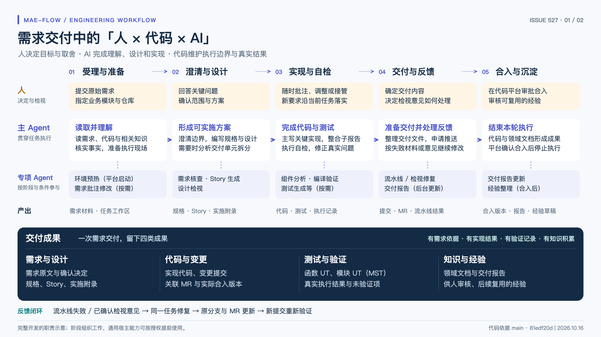

# 需求交付协作图

- [高清 PNG](delivery-collaboration.png)：3840 × 2160，16:9，可直接插入演示文稿。
- [可编辑 SVG](delivery-collaboration.svg)：1920 × 1080 矢量源文件，可调整文字与布局。

图示沿需求交付的五个阶段，说明人、主 Agent 与专项 Agent 的分工。底部汇总需求与设计、代码与变更、测试与验证、知识与经验四类交付成果。

这是 [Issue 527](https://github.com/yunine9/mae-flow-cloud/issues/527) 确认后的主图版本，内容依据 `main` 的 `81edf20d`（2026-10-16）。图中的阶段为介绍用概括；具体角色与调用次数取决于任务条件。

图中文字使用 PingFang SC / Microsoft YaHei 等系统字体。若编辑环境缺少相应字体，可替换为可用的中文字体；直接展示建议使用 PNG。
