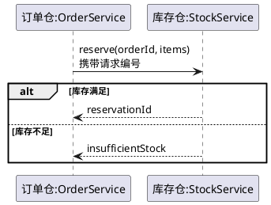
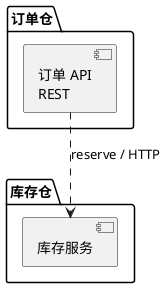
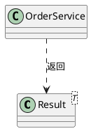
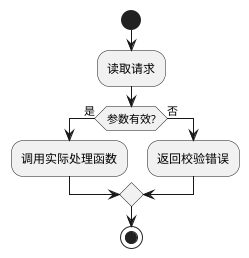
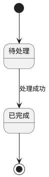

# PlantUML 写作与错误修正

首次绘图、切换图类型或收到校验错误时按需读取本页；主会话和无图文稿无需反复加载。下面都是语法示意，名称、方法、参数、条件与状态必须替换为实际源码事实。实际校验结果决定本环境是否能解析，不能用一张看似规范的模板代替校验。

## 通用做法

一张图放在一个 plantuml 代码块内，使用一对 `@startuml` / `@enduml`。先选定时序、组件、类、活动或状态图类型，再使用该类型的结构，避免把时序的 `alt/end` 与活动的 `if/endif` 混在一起。

优先使用简单、自包含的常见写法，每个代码块放一张图，把必要声明放在图内。命名的 `@startuml`、合法预处理指令、函数或主题不因形式本身被禁止，是否可用由平台内置版本的真实解析器判断。渲染器以 SANDBOX 模式运行，不允许访问文件或 URL 资源；不要依赖外部资源，也不要把这种访问限制误称为所有预处理或函数都存在语法错误。

显示名称与连接用的标识分开：显示文本可加引号，连接使用简单唯一别名。`::`、`<>`、括号和斜杠不是一律非法；已正确引用的名称不能只因含这些字符就判错。别名不要复用于不同对象。组件与类的显示名称/别名写法见 [组件图官方文档](https://plantuml.com/component-diagram) 和 [类图官方文档](https://plantuml.com/class-diagram)。

图中文字要换行时可使用字面 `\n`。通过 JSON 参数保存 Markdown 时，需要正确转义，使最终正文保留所需的反斜杠与 n，而不是在声明语句内意外插入换行。检查保存后的正文，不把工具参数中的转义层数当作最终图源码。

复杂图按完整子流程分图，标明前后衔接、输入和输出；保留源码中的业务条件、关键分支与跨仓边界。不要为让解析通过删掉条件或失败路径，不因节点或参与者超过某个数字合并真实业务对象。

## 时序图

参与者可以自动创建，未显式 participant 不构成语法错误。本方法推荐对跨仓或含特殊字符的名称显式声明与命名，便于核对真实边界。消息标签支持 `\n`，无需一律改成单行或额外加引号。分组使用 `alt/else/end`、`opt/end`、`loop/end` 等，多行注释以 `end note` 结束；嵌套分组逐层闭合。见 [时序图官方文档](https://plantuml.com/en/sequence-diagram)。



示例分支只说明语法，真实幂等检查、认证和状态写入的先后顺序必须按代码重画。需要激活条时保持 activate/deactivate 的对象与生命周期一致；没有必要时不添加装饰性激活条。

## 组件/架构图

使用真实组件声明，连接别名；package 用花括号包围成员，不用时序图的 box/end box 来代替。组件图的连线描述结构依赖，不能仅靠箭头样式推断运行时的同步/异步语义。见 [组件图官方文档](https://plantuml.com/component-diagram)。



## 类与模块关系图

类名可使用泛型；不要把 `<T>` 本身报为语法错误。复杂显示名可加引号并给别名，后续关系使用别名。花括号、关系方向和成员声明应符合类图语法；只画实际继承、组合或依赖，不为函数式代码虚构类。见 [类图官方文档](https://plantuml.com/class-diagram)。



## 活动图

采用一种活动图语法，不混用旧式活动节点与新式控制结构。下面新式写法的动作以冒号开始、分号结束，条件以 endif 结束；循环与并行结构也使用各自闭合语句。见 [活动图官方文档](https://plantuml.com/activity-diagram-beta)。



## 状态图

`[*]` 表示起点或终点，转换标注真实事件和条件。显示名与别名分开，复合状态的花括号配对；不要把活动图的 start/stop 混进状态转换。状态必须对应实体的真实生命周期。见 [状态图官方文档](https://plantuml.com/state-diagram)。



## 根据真实报告修正

保存文稿后调用：

```json
{"document_id":"实际文稿编号","start":0,"limit":10}
```

工具名为 knowledge_diagram_check。返回 document_id、fingerprint、status、total、checked、diagrams 和可选 next_start；diagrams 每项含从 1 开始的 index、文稿中的 line、status 及可能的 error。按 next_start 继续读报告，不能只核对第一页。按图序号、文稿行与 error 中的诊断读取当前图及附近结构：报错位置可能是未闭合结构的后继行，先检查引号、别名、括号、分组、注释和代码块配对，再修正具体错误。

过程规划使用同一工具，参数改为 `{"work_document_id":"current-plan","start":0,"limit":10}`；返回的定位字段为 work_document_id，其余报告格式相同。document_id 与 work_document_id 必须且只能填一个。先保存过程稿再查，规划登记和最终完成前也须通过；无需生成一份知识文稿来代替规划。

修正后保存同一文稿并重新校验当前版本；旧 fingerprint 的成功结果不能证明新图有效。`invalid` 表示实际检测到需要修正的问题，按具体 error 区分解析错误和平台支持范围限制。`unavailable` 表示 Java、渲染依赖、资源限制、超时等使校验未完成，不能据此改写业务事实或称为语法错误。

修改后同一张图再次出现相同错误时，回读错误附近的完整结构及对应语法示例。每次写作会话最多做两轮图表自检修正；仍未通过就提交已保存候选，在 summary/data 列出未解决的图序号、诊断和已尝试修改，由宿主按剩余修订次数处理。不要靠不断重复相同工具调用延长单次写作。

遇到 unavailable，写作者提交已保存的候选并在 summary/data 记录实际阻碍；宿主会保留候选、中断该项，主会话继续独立项后报告阻碍。不要重复改图或删除图，依赖失败不消耗自动修订次数。评审不能在 unavailable 时提交 pass=true，须报告尚未完成的校验及其原因。

`valid` 只证明当前文稿版本中的图可被平台随代码提供的 PlantUML 版本渲染，不保证其他版本或环境的结果。随后仍须核对源码事实、分支覆盖、可读性和模板要求；total=0 即使返回 valid，也只说明文稿没有可校验图，不证明它满足应有的场景图要求。宿主会在候选后、独立评审前再次校验；评审仍须调用工具读取当前版本报告，不能只引用作者声称的结果。
