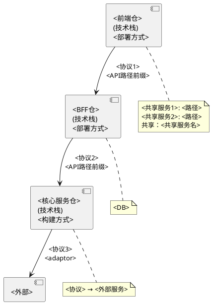
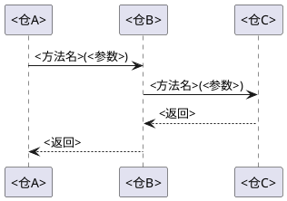
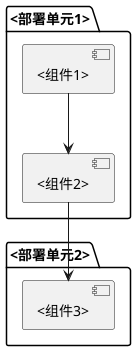

# 架构全景

> 系统整体架构与调用链，每跳的协议与技术栈。
> 模板来源：`templates/domain/architecture.md`

## 一、系统架构图

<!-- 使用 PlantUML 绘制系统级架构图，展示所有仓、外部系统、协议标注、关键路径 -->
<!-- 框图中标注：仓名、技术栈、部署方式、协议、路径/API前缀 -->
<!-- 下方用"共享"标注跨层共享的服务（如 Session、File Service） -->
<!-- 外部系统（如 DB、媒体服务）用分支从对应仓引出 -->

## 二、分层职责

<!-- 用表格描述每一层的职责边界，明确"不负责"什么 -->

| 层 | 仓 | 一句话职责 | 不负责 |
|----|-----|-----------|--------|
| 前端 | <前端仓> | <职责> | <不负责的内容> |
| <适配层名> | <BFF仓> | <职责> | <不负责的内容> |
| <核心层名> | <核心服务仓> | <职责> | <不负责的内容> |
| 外部 | <外部系统> | <职责> | — |

## 三、调用链详解

### 链路一：<链路名称>

<!-- 描述一条完整的端到端调用链路 -->

**场景**：<触发场景>

| 跳序 | 来源 | 目标 | 协议 | 技术栈 | 说明 |
|------|------|------|------|--------|------|
| 1 | <仓A> | <仓B> | <REST/CORBA/gRPC/...> | <框架> | <传什么数据、做什么> |
| 2 | <仓B> | <仓C> | <协议> | <框架> | <传什么数据、做什么> |
| 3 | <仓C> | <外部> | <协议> | <框架> | <传什么数据、做什么> |

### 链路二：<链路名称>

<!-- 重复上述结构 -->

## 四、技术栈总览

| 仓 | 语言 | 框架 | 通信协议 | 数据存储 | 构建工具 |
|----|------|------|---------|---------|---------|
| <仓A> | <语言> | <框架> | <协议> | <存储> | <工具> |
| <仓B> | <语言> | <框架> | <协议> | <存储> | <工具> |

## 五、部署拓扑

<!-- 简述部署架构，如容器化、微服务编排等 -->

