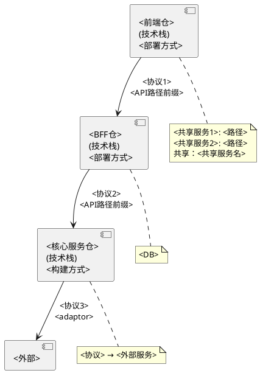
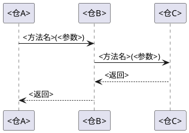
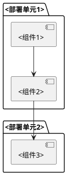

# 架构全景

> 系统整体架构与调用链，每跳的协议与技术栈。

<!-- 按实际仓、运行边界和调用关系展开。下方前端/BFF/核心及各类存储只是示例角色，未在源码和配置中证实的层、节点、协议与部署方式不写成现状。仓库不等同于部署单元，进程内第三方库也不自动等同于外部系统。 -->

## 一、系统架构图

<!-- 使用 PlantUML 绘制系统级架构图，展示所有仓、外部系统、协议标注、关键路径 -->
<!-- 节点与调用边逐项注明实际来源；无外部系统时仅画真实仓及关系。图过大时按业务链路拆图，保留跨图衔接，避免为缩图删除实际调用方、分支或边界。 -->
<!-- 框图中标注：仓名、技术栈、部署方式、协议、路径/API前缀 -->
<!-- 下方用"共享"标注跨层共享的服务（如 Session、File Service） -->
<!-- 外部系统（如 DB、媒体服务）用分支从对应仓引出 -->

## 二、分层职责

<!-- 用表格描述每一层的职责边界，明确"不负责"什么 -->

| 实际层/运行单元 | 仓或系统 | 职责 | 边界 | 依据 |
|-----------------|----------|------|------|------|
| <真实层或单元名称> | <实际仓或外部系统> | <职责> | <已查证的边界；未确定则说明> | <源码、配置或资料位置> |

## 三、调用链详解

### 链路一：<链路名称>

<!-- 按已盘点的完整业务链路展开，不限定为用户请求；定时、事件及批处理入口同样覆盖。实际方法名、参数、返回处理及异常传播有源码依据；建议或未知明确标识。 -->

**场景**：<触发场景>

**适用条件与依据**：<入口、配置条件、版本及实际读取位置>

| 跳序 | 来源 | 目标 | 协议 | 技术栈 | 说明 |
|------|------|------|------|--------|------|
| 1 | <仓A> | <仓B> | <REST/CORBA/gRPC/...> | <框架> | <传什么数据、做什么> |
| 2 | <仓B> | <仓C> | <协议> | <框架> | <传什么数据、做什么> |
| 3 | <仓C> | <外部> | <协议> | <框架> | <传什么数据、做什么> |

### 链路二：<链路名称>

<!-- 按实际链路数量重复上述结构；已在业务域文稿完整展开的细节链接到真实场景，本节保留仓间关系与关键条件。 -->

## 四、技术栈总览

| 仓 | 语言 | 框架 | 通信协议 | 数据存储 | 构建工具 |
|----|------|------|---------|---------|---------|
| <仓A> | <语言> | <框架> | <协议> | <存储> | <工具> |
| <仓B> | <语言> | <框架> | <协议> | <存储> | <工具> |

## 五、部署拓扑

<!-- 依据实际部署文件或上传资料说明部署单元、连接和适用环境；将仓/构建关系与部署拓扑区分。没有部署依据时保留本节说明已检查范围及未知，不按技术栈猜测容器、集群或副本数。此时不输出猜测的部署图。 -->

