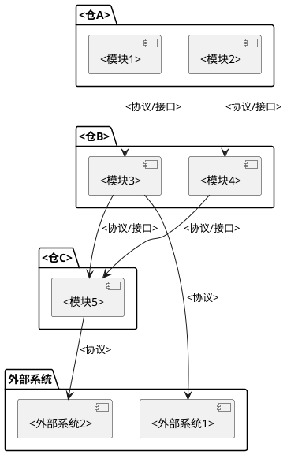
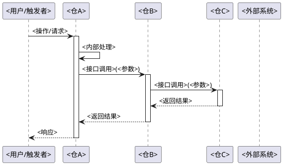
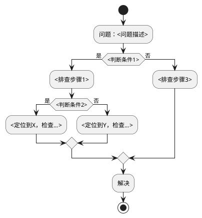

# 业务域：<域名称>

> 跨仓业务域：链路、实体与状态机、典型场景走查、排查路径。
> 模板来源：`templates/domain/domain.md`

## 一、域概述

<!-- 一段话描述该业务域的边界、目标和核心价值 -->

**涉及仓**：<仓A>, <仓B>, <仓C>, ...

## 二、域边界

<!-- 明确界定什么属于本域、什么不属于，避免将代码目录相邻但业务无关的功能纳入 -->

**属于本域的功能**：
- <功能1>：<为什么属于>
- <功能2>：<为什么属于>

**不属于本域的相邻功能**：
- <相邻功能1>：属于 `<其他域名>` 域，原因：<为什么不属于本域>
- <相邻功能2>：属于 `<其他域名>` 域，原因：<为什么不属于本域>

## 三、域架构图

<!-- 使用 PlantUML 绘制该业务域涉及的仓和模块之间的关系 -->



## 四、端到端链路

<!-- 先枚举该域的所有独立用户场景，再逐个展开。每个场景内部把核心实体、状态机、调用链路讲清楚，不拆分到多个章节 -->

### 1. 场景列表

| 序号 | 场景名称 | 触发条件 | 与其他场景的差异 |
|------|---------|---------|----------------|
| 1 | <场景1> | <何时触发> | <与场景2/3的区别> |
| 2 | <场景2> | <何时触发> | <与场景1的区别> |

### 2. 场景：<场景名称>

<!-- 一个场景内部完整讲清楚：核心实体与关键字段、状态机、端到端调用链路。不拆分到其他章节 -->

**前置条件**：<条件>

**参与方**：<角色/仓/外部系统>

**核心实体**：

| 字段 | 类型 | 含义 | 来源 |
|------|------|------|------|
| <字段A> | <类型> | <含义> | <哪个仓产生> |
| <字段B> | <类型> | <含义> | <哪个仓产生> |

**状态机**（按需，当场景涉及实体状态流转时补充）：

```plantuml
@startuml
[*] --> <状态A>
<状态A> --> <状态B> : <触发条件/事件>
<状态B> --> <状态C> : <触发条件/事件>
<状态C> --> [*] : <结束条件>
<状态B> --> <状态A> : <回退条件>
@enduml
```

**时序图**（**必须绘制，不可省略**）：

<!-- 每个场景必须有自己的时序图。时序图是讲清楚端到端调用链路的核心手段，不能偷懒省略。
     参与者以仓为单位命名（如 仓A、仓B、外部系统），跨仓调用箭头标注真实接口名和参数。
     如果场景内部有多个子流程，每个子流程也需单独绘制时序图。 -->



## 五、环境存储位置

<!-- 该业务域在各仓中的文件/数据存储路径、容量限制。按链路阶段组织，不按仓组织 -->

### 1. <链路方向，如"导入链路存储" / "导出链路存储">

| 阶段 | 存储位置 | 所属仓 | 说明 |
|------|---------|--------|------|
| <阶段1> | <路径/桶名> | <仓> | <什么数据、格式、生命周期> |

### 2. 容量限制配置

| 配置项 | 值 | 来源 | 说明 |
|--------|-----|------|------|
| <配置项1> | <值> | <文件:行号 或 配置文件> | <限制什么> |

## 六、临时空间与定时删除机制

<!-- 该业务域涉及的临时文件/内存对象的清理策略。区分各仓的调度方式、TTL、清理范围 -->

| 清理对象 | 执行方 | 调度周期 | TTL | 清理方式 |
|----------|--------|---------|-----|---------|
| <对象1> | <仓/组件> | <cron表达式/间隔秒> | <时长> | <删除逻辑> |

<!-- 如有即时清理（事件触发型），单独说明 -->

## 七、DFX 场景

<!-- Design for Excellence：流量控制、超时与重试、安全机制、审计日志、可观测性等 -->

### 1. 流量控制

| 控制点 | 限制值 | 配置来源 | 机制 |
|--------|--------|---------|------|
| <控制点1> | <值> | <配置文件> | <限流/排队/拒绝策略> |

### 2. 超时与重试

| 场景 | 超时/重试配置 | 来源 |
|------|-------------|------|
| <场景1> | <值> | <文件:行号> |

### 3. 安全机制

| 安全维度 | 机制 | 实现位置 |
|----------|------|---------|
| <维度1> | <校验/加密/权限> | <文件> |

### 4. 审计日志

| 操作 | 审计类型 | 实现位置 |
|------|---------|---------|
| <操作1> | <日志类型> | <文件> |

### 5. 可观测性

<!-- 日志级别、关键日志消息、进度查询接口、健康检查、监控指标 -->

| 可观测项 | 机制 | 实现位置 |
|----------|------|---------|
| <项1> | <日志/接口/指标> | <文件> |

## 八、排查路径

<!-- 当该业务域出现问题时，推荐的排查步骤 -->



**排查清单**：

- [ ] 检查 <仓A> 的 <日志/指标>
- [ ] 检查 <仓B> 的 <日志/指标>
- [ ] 验证 <接口> 连通性
- [ ] 检查 <配置项>

## 九、关联文档

- [架构全景](../architecture.md)
- [接口契约：<仓A-仓B>](../interfaces/<仓A-仓B>.md)
- <仓A> 模块文档：`<仓A>/docs/modules/<模块>/<模块名>.md`
- <仓B> 模块文档：`<仓B>/docs/modules/<模块>/<模块名>.md`
