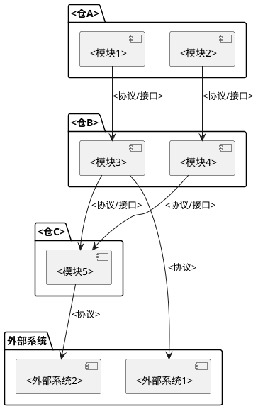
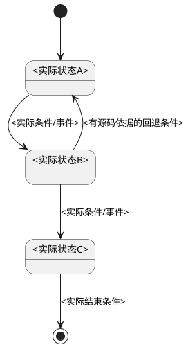
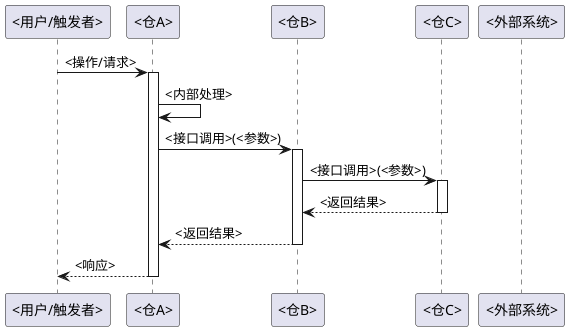
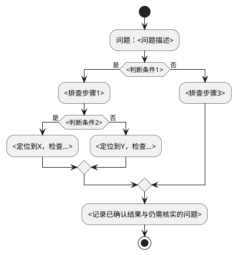

# 业务域：<域名称>

> 业务域：完整链路、实体与状态变化、场景及排查路径。

<!-- 业务域在所选 module_id/scope 内按独立业务意图和完整场景划分，不以仓数为前提。必要跨业务依赖作为边界说明，不扩展成其他业务的完整研究。场景、参与仓、相邻域按实际发现展开；章节不适用时说明核查范围。业务目标和设计原因依资料，现有行为依源码，冲突保留差异。 -->

## 一、域概述

<!-- 一段话描述该业务域的边界、目标和核心价值 -->

**涉及仓**：<仓A>, <仓B>, <仓C>, ...

## 二、域边界

<!-- 明确界定什么属于本域；仅列确实识别出的相邻功能，没有相邻域时说明范围，不为填示例虚构域。 -->

**属于本域的功能**：
- <功能1>：<为什么属于>
- <功能2>：<为什么属于>

**不属于本域的相邻功能**：
- <相邻功能1>：属于 `<其他域名>` 域，原因：<为什么不属于本域>
- <相邻功能2>：属于 `<其他域名>` 域，原因：<为什么不属于本域>

## 三、域架构图

<!-- 使用 PlantUML 绘制实际涉及的仓、模块及外部系统。下方角色和调用边均须替换为真实关系；没有跨仓或外部交互时不添加对应节点。 -->

## 四、端到端链路

<!-- 先枚举所有独立业务场景，涵盖用户操作、公开接口、定时任务、事件和自动处理。按唯一入口和行为对应关系去重，允许多个入口汇入同一场景，但列清入口及条件。每个场景内部讲清实体、状态变化和完整调用链。 -->

### 1. 场景列表

| 序号 | 场景名称 | 触发条件 | 与其他场景的差异 |
|------|---------|---------|----------------|
| 1 | <场景1> | <何时触发> | <与场景2/3的区别> |
| 2 | <场景2> | <何时触发> | <与场景1的区别> |

### 2. 场景：<场景名称>

<!-- 一个场景内部完整讲清楚：核心实体与关键字段、状态机、端到端调用链路。不拆分到其他章节 -->

**前置条件**：<条件>

**触发入口与依据**：<实际入口、源码位置和相关资料章节；记录配置开关及适用范围>

**参与方**：<角色/仓/外部系统>

**核心实体**：

| 字段 | 类型 | 含义 | 来源 |
|------|------|------|------|
| <字段A> | <类型> | <含义> | <哪个仓产生> |
| <字段B> | <类型> | <含义> | <哪个仓产生> |

**状态机**（按需，当场景涉及实体状态流转时补充）：

**时序图**（每个实际场景均须绘制）：

<!-- 每个实际场景用时序图讲清完整链路。
     参与者以仓为单位命名（如 仓A、仓B、外部系统），跨仓调用箭头标注真实接口名和参数。
     保留影响业务结果的条件、异常传播与副作用先后，可用 alt/else/opt/loop 表达。
     有独立入口或不同处理终点的子流程分别展开；仅参数不同且处理相同的分支可在本场景图中表达，避免重复生产相同流程。
     图过大时按真实子流程拆图并注明衔接，不合并不同仓来掩盖调用边界。 -->

**条件、异常与结果**：

| 条件或异常 | 判断/动作顺序 | 状态与副作用 | 返回及后续处理 | 依据 |
|------------|---------------|-------------|----------------|------|
| <实际分支> | <先校验什么，再执行什么> | <已发生、未发生或待确认的变化> | <调用方实际处理> | <源码位置> |

<!-- 对重复请求、部分成功、补偿和清理说明成立条件；代码未实现相应机制时如实说明，不补写理想行为。 -->

## 五、环境存储位置

<!-- 按实际链路阶段说明存储介质、位置表达式和生命周期；区分内存、文件、数据库等。源码默认路径不等于部署实值，未提供环境值时说明未知。无持久化、容量配置或临时空间时说明已检查范围，不填推测值。 -->

### 1. <链路方向，如"导入链路存储" / "导出链路存储">

| 阶段 | 存储位置 | 所属仓 | 说明 |
|------|---------|--------|------|
| <阶段1> | <路径/桶名> | <仓> | <什么数据、格式、生命周期> |

### 2. 容量限制配置

| 配置项 | 默认值及单位 | 覆盖方式/实际值状态 | 来源 | 作用条件 |
|--------|--------------|-------------------|------|----------|
| <实际配置项> | <已查证默认值；无默认则说明> | <环境覆盖位置；实值未提供则说明> | <源码或配置位置> | <限制对象及适用分支> |

## 六、临时空间与定时删除机制

<!-- 该业务域涉及的临时文件/内存对象的清理策略。区分各仓的调度方式、TTL、清理范围 -->

| 清理对象 | 执行方/入口 | 触发条件与调度周期 | TTL/判定边界 | 清理动作及失败处理 | 依据 |
|----------|-------------|-------------------|-------------|-------------------|------|
| <实际对象> | <仓/组件及方法> | <实际表达式或事件；单位> | <实际比较条件；无TTL则说明> | <动作顺序、状态变化与异常分支> | <源码位置> |

<!-- 如有即时清理（事件触发型），单独说明 -->

## 七、DFX 场景

<!-- Design for Excellence：流量控制、超时与重试、安全机制、审计日志、可观测性等 -->
<!-- 每项区分已实现、在检查范围内未发现及缺少外部配置而无法确认。业务调用日志不自动等于审计能力，异常捕获不自动等于重试，存在标识字段不自动等于幂等。 -->

### 1. 流量控制

| 控制点 | 限制值 | 配置来源 | 机制 |
|--------|--------|---------|------|
| <控制点1> | <值> | <配置文件> | <限流/排队/拒绝策略> |

### 2. 超时与重试

| 场景 | 超时/重试配置 | 来源 |
|------|-------------|------|
| <场景1> | <值> | <文件:行号> |

### 3. 安全机制

| 安全维度 | 机制 | 实现位置 |
|----------|------|---------|
| <维度1> | <校验/加密/权限> | <文件> |

### 4. 审计日志

| 操作 | 审计类型 | 实现位置 |
|------|---------|---------|
| <操作1> | <日志类型> | <文件> |

### 5. 可观测性

<!-- 日志级别、关键日志消息、进度查询接口、健康检查、监控指标 -->

| 可观测项 | 机制 | 实现位置 |
|----------|------|---------|
| <项1> | <日志/接口/指标> | <文件> |

## 八、排查路径

<!-- 按实际实现和可观测点给出建议检查顺序；这是排查建议，不声称历史事故、根因或修复已经验证。流程终点根据证据写已定位或需补充信息，不保证执行即解决。 -->

**排查清单**：

- [ ] 检查 <仓A> 的 <日志/指标>
- [ ] 检查 <仓B> 的 <日志/指标>
- [ ] 验证 <接口> 连通性
- [ ] 检查 <配置项>

## 九、关联文档

- [架构全景](../architecture.md)
- [接口契约：<仓A-仓B>](../interfaces/<仓A-仓B>.md)
- <实际目标仓>：`<该仓实际功能文稿路径，新仓级默认 docs/modules/业务功能/业务功能名.md>`

<!-- 只列真实产物；同仓使用相对链接，跨仓标明目标仓与仓内路径，不构造本知识仓内并不存在的仓目录。 -->
