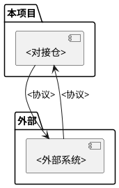

# 外部系统画像：<系统名称>

> 外部系统的角色、接口、约束与交互模式。
> 模板来源：`templates/domain/external-system.md`

## 一、系统概述

| 项目 | 内容 |
|------|------|
| 系统名称 | <名称> |
| 系统类型 | <网元/数据库/消息队列/文件系统/第三方服务/...> |
| 角色 | <在本项目中扮演什么角色> |
| 对接仓 | <哪个仓直接与此系统通信> |

## 二、交互架构

## 三、接口清单

### 接口一：<接口名称>

| 项目 | 内容 |
|------|------|
| 方向 | <项目 → 外部 / 外部 → 项目> |
| 协议 | <SNMP/CORBA/REST/FTP/SFTP/...> |
| 触发方式 | <定时/事件/手动> |
| 数据格式 | <格式描述> |

**关键参数**：

| 参数 | 含义 | 示例值 |
|------|------|--------|
| <参数A> | <含义> | <示例> |

## 四、约束与限制

| 约束类型 | 描述 |
|---------|------|
| 连接数限制 | <描述> |
| 并发限制 | <描述> |
| 数据量限制 | <描述> |
| 超时要求 | <描述> |
| 版本兼容性 | <描述> |

## 五、依赖关系

**本项目依赖此系统提供的**：
- <能力1>
- <能力2>

**此系统依赖本项目提供的**：
- <能力1>（如果是双向交互）

## 六、常见问题

| 问题 | 原因 | 解决方案 |
|------|------|---------|
| <问题1> | <原因> | <方案> |
