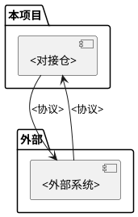

# 外部系统画像：<系统名称>

> 外部系统在本业务中的角色、实际使用接口、约束与交互模式；共享系统的无关业务能力不纳入本次画像。

<!-- 只为存在实际运行时交互的独立外部系统生成画像。进程内库、纯构建依赖不自动视为外部系统；部署与所有者边界缺资料时明确未知。接口与限制数量按真实发现展开。 -->

## 一、系统概述

| 项目 | 内容 |
|------|------|
| 系统名称 | <名称> |
| 系统类型 | <网元/数据库/消息队列/文件系统/第三方服务/...> |
| 角色 | <在本项目中扮演什么角色> |
| 对接仓 | <哪个仓直接与此系统通信> |
| 查证范围 | <实际客户端、协议配置与资料位置；外部实现是否可读> |

## 二、交互架构

<!-- 根据真实消息流保留箭头；单向交互不画独立反向调用，响应与回调分别标注。外部系统内部未知实现不补画。 -->

## 三、接口清单

### 接口一：<接口名称>

| 项目 | 内容 |
|------|------|
| 方向 | <项目 → 外部 / 外部 → 项目> |
| 协议 | <SNMP/CORBA/REST/FTP/SFTP/...> |
| 触发方式 | <定时/事件/手动> |
| 数据格式 | <格式描述> |
| 实际入口与依据 | <调用或消费位置、配置和协议资料> |

**关键参数**：

| 参数 | 含义与约束 | 来源/示例性质 |
|------|------------|---------------|
| <实际参数> | <用途、必填条件及编码> | <真实默认值或明确标注的脱敏示例；未知不填推测值> |

**返回、异常与恢复**：<实际响应或消息确认、超时、重连、重试、重复处理和失败后的状态；逐项给出依据与成立条件，未实现或未知明确说明>

## 四、约束与限制

| 约束类型 | 已知限制及作用条件 | 来源与未知范围 |
|---------|-------------------|----------------|
| <连接/并发/数据量/超时/兼容性等实际约束> | <客户端限制或外部系统限制分别说明> | <源码、协议或资料位置；外部未公开限制明确未知> |

<!-- 未找到限制配置不等于无限制。源码默认值不等于部署实值；区分本项目主动限制和外部服务保证。 -->

## 五、依赖关系

**本项目依赖此系统提供的**：
- <能力1>
- <能力2>

**此系统依赖本项目提供的**：
- <能力1>（如果是双向交互）

<!-- 不存在反向能力时说明实际范围内仅本项目发起调用，不为填满模板构造反向依赖。 -->

## 六、常见问题

<!-- 有真实问题记录时列证实的现象、根因和处理结果；仅据客户端代码推导的检查点标为排查建议，不能冒充已发生事故。没有案例时说明当前依据范围。 -->

| 现象/检查点 | 记录性质 | 已确认原因或待核实条件 | 实际结果/排查建议 | 依据 |
|-------------|----------|------------------------|-------------------|------|
| <真实现象或建议检查点> | <真实案例/排查建议> | <证实结论或条件> | <区分已验证与建议> | <记录或源码位置> |
