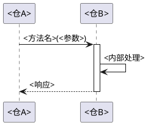

# 跨仓接口契约：<仓A> → <仓B>

> 两仓之间的接口协议、超时/重试/幂等、变更记录。

<!-- 按真实调用方→被调用方组织文件，双方都发起独立调用时分别列清方向和接口。接口数量按实际清单展开；调用端与实现端分别核对，缺失一端时明确可确认的范围及未知。响应消息不自动构成反向业务调用。 -->

## 一、契约概述

| 项目 | 内容 |
|------|------|
| 上游仓 | <仓A> |
| 下游仓 | <仓B> |
| 通信协议 | <REST / CORBA / gRPC / 二进制 / ...> |
| 序列化 | <JSON / Avro / Protobuf / CORBA CDR / ...> |
| 认证方式 | <方式> |
| 依赖方向 | <仓A> 依赖 <仓B> |

## 二、接口列表

### 接口一：<接口名称>

**用途**：<一句话描述>

**调用方向**：<仓A> → <仓B>

**定义位置**：
- 调用方：`<仓编号>:<文件路径>:<起始行>-<末行>`
- 实现方：`<仓编号>:<文件路径>:<起始行>-<末行>`
- IDL/接口定义：`<仓编号>:<定义文件路径>`（按实际存在情况填写）

**触发条件**：<实际业务入口、配置条件及适用范围>

**请求参数**：

| 参数名 | 类型 | 必填 | 含义 | 约束 |
|--------|------|------|------|------|
| <参数A> | <类型> | 是 | <含义> | <约束> |
| <参数B> | <类型> | 否 | <含义> | <约束> |

**响应结构**：

| 字段 | 类型 | 含义 |
|------|------|------|
| <字段A> | <类型> | <含义> |
| <字段B> | <类型> | <含义> |

**时序图**：

<!-- 标明实际参数构造、请求、返回处理及影响结果的分支；同步返回、异步回调和消息确认按真实协议分别表达。仅展示有源码或协议依据的调用。 -->

**超时、重试与重复请求**：

| 项目 | 实际机制与成立条件 | 配置来源/覆盖方式 | 依据 |
|------|--------------------|------------------|------|
| 超时 | <调用端/服务端分别说明数值、单位及超时后的行为；未配置或未知按实说明> | <默认与环境覆盖区分> | <源码或配置位置> |
| 重试 | <触发异常、总尝试次数或额外重试次数、间隔及终止条件> | <实际来源> | <源码位置> |
| 重复请求 | <去重键、检查顺序、有效期、作用范围与条件；不可只写是/否> | <实际来源或不适用> | <源码位置> |

**条件与副作用顺序**：

| 条件/失败阶段 | 已完成动作 | 保留或撤销的副作用 | 调用方实际后续处理 | 依据 |
|---------------|------------|-------------------|--------------------|------|
| <实际校验、调用或响应分支> | <执行顺序> | <状态/数据/外部动作变化> | <真实处理或未实现> | <双端源码位置> |

**错误码**：

| 错误码/异常 | 产生条件 | 传播或转换方式 | 调用方实际处理 | 依据 |
|-------------|----------|---------------|----------------|------|
| <实际值或异常类型> | <真实分支> | <保留/包装/吞掉/转换> | <真实处理；未找到则说明范围> | <双端位置> |

<!-- 若有改进建议，明确标为建议，不能将其写成调用方已实现的处理。无结构化错误码时描述实际错误形式。 -->

**注意事项**：
- <注意1>
- <注意2>

### 接口二：<接口名称>

<!-- 仅在实际存在更多接口时重复上述结构，覆盖全部范围内接口，不为凑数量编写接口。 -->

## 三、变更记录

<!-- 仅根据真实提交、变更资料或已确认记录填写；没有变更依据时说明本次只核对当前版本，不生成日期、人名或虚构历史。 -->

| 日期/版本 | 变更内容 | 影响接口 | 记录来源 |
|-----------|---------|---------|----------|
| <有证据的日期或版本> | <已确认变更> | <接口名> | <实际记录位置> |
