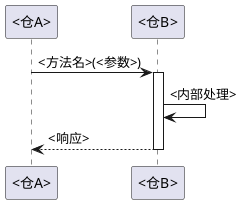

# 跨仓接口契约：<仓A> → <仓B>

> 两仓之间的接口协议、超时/重试/幂等、变更记录。
> 模板来源：`templates/domain/interface-contract.md`

## 一、契约概述

| 项目 | 内容 |
|------|------|
| 上游仓 | <仓A> |
| 下游仓 | <仓B> |
| 通信协议 | <REST / CORBA / gRPC / 二进制 / ...> |
| 序列化 | <JSON / Avro / Protobuf / CORBA CDR / ...> |
| 认证方式 | <方式> |
| 依赖方向 | <仓A> 依赖 <仓B> |

## 二、接口列表

### 接口一：<接口名称>

**用途**：<一句话描述>

**调用方向**：<仓A> → <仓B>

**定义位置**：
- 上游调用：`<仓A>/<文件路径>:<行号>`
- 下游实现：`<仓B>/<文件路径>:<行号>`
- IDL/接口定义：`<仓>/<IDL文件路径>`

**请求参数**：

| 参数名 | 类型 | 必填 | 含义 | 约束 |
|--------|------|------|------|------|
| <参数A> | <类型> | 是 | <含义> | <约束> |
| <参数B> | <类型> | 否 | <含义> | <约束> |

**响应结构**：

| 字段 | 类型 | 含义 |
|------|------|------|
| <字段A> | <类型> | <含义> |
| <字段B> | <类型> | <含义> |

**时序图**：

**超时与重试**：

| 项目 | 值 |
|------|-----|
| 超时时间 | <X 秒> |
| 重试次数 | <N 次> |
| 重试策略 | <固定间隔/指数退避/不重试> |
| 幂等性 | <是/否> |

**错误码**：

| 错误码 | 含义 | 上游处理建议 |
|--------|------|------------|
| <CODE_1> | <含义> | <处理方式> |
| <CODE_2> | <含义> | <处理方式> |

**注意事项**：
- <注意1>
- <注意2>

### 接口二：<接口名称>

<!-- 重复上述结构 -->

## 三、变更记录

| 日期 | 变更内容 | 影响接口 | 变更人 |
|------|---------|---------|--------|
| <YYYY-MM-DD> | <描述> | <接口名> | <人> |
