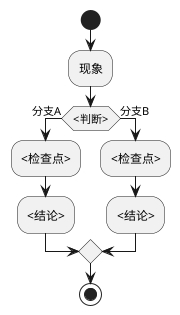

# 排查经验：<机制名称>

> 本业务的真实排查案例正文，按机制拆分，保存在对应功能的 experience/ 目录；不因同仓关系扩展收集其他业务事故。

<!-- 仅在有可回查真实案例时使用。按实际发生的调查顺序与证据填写，示例步骤数不是最低数量；缺少日志、修复或验证结果时写清缺口，不能据异常处理代码补造事故。案例未解决仍可记录，状态必须准确。 -->

**案例来源与状态**：<真实记录位置、发生版本/环境及已确认/待验证/未解决状态>

## 一、场景

<!-- 描述触发此排查的场景背景 -->

**现象**：<可观测的现象描述>

**触发条件**：<什么情况下会出现>

## 二、排查过程

### 步骤一：定位问题范围

<!-- 描述如何缩小问题范围 -->

**排查方法**：<方法>

**关键日志/指标**：

```
<实际案例中的脱敏日志或指标；没有记录时删除本块并说明缺失>
```

**结论**：<排查得出的方向>

### 步骤二：深入分析

<!-- 描述根因分析过程 -->

**分析路径**：



**关键代码**：

- `<仓编号>:<文件路径>:<行号>` — <这段代码做了什么>
- `<仓编号>:<文件路径>:<行号>` — <这段代码做了什么>

### 步骤三：根因确认

**根因**：<一段话描述根本原因>

<!-- 未得到充分证据时明确写待验证假设，列出支持与反对证据及下一步核实条件，不因章节名“根因确认”而宣称已确认。 -->

**证据链**：

1. <证据1>
2. <证据2>
3. <证据3>

## 三、解决方案

**修复方式**：<描述>

**实施状态**：<建议方案/已实施/已验证，按真实记录填写>

**修复位置**：`<仓编号>:<文件路径>:<行号>`

**修复代码**（关键片段）：

```
<关键代码片段>
```

**验证记录**：<实际执行的检查、环境、版本和结果；尚未执行则明确未验证>

<!-- 未实施的方案标为建议，不填写虚构的修复位置或“修复后正常”；仅在存在实际修复片段时保留代码块。 -->

## 四、预防措施

- <依据已确认机制提出的建议或已落实措施，明确区分状态>

## 五、关联

- 模块文档：`../<模块名>.md`
- 相关功能点：<模块文稿中真实存在的章节；确认锚点后附链接>
- 相关排查说明：<模块文稿“排查经验”中的真实位置或关联业务域的“排查路径”>

<!-- 链接按实际相对位置填写，不构造模板没有的“路由”章节或未经核对的锚点。跨仓引用写明目标仓与仓内路径。 -->
