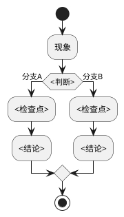

# 排查经验：<机制名称>

> 复杂排查案例正文，按机制拆分。
> 模板来源：`templates/repo/experience.md`

## 一、场景

<!-- 描述触发此排查的场景背景 -->

**现象**：<可观测的现象描述>

**触发条件**：<什么情况下会出现>

## 二、排查过程

### 步骤一：定位问题范围

<!-- 描述如何缩小问题范围 -->

**排查方法**：<方法>

**关键日志/指标**：

```
<日志片段或指标示例>
```

**结论**：<排查得出的方向>

### 步骤二：深入分析

<!-- 描述根因分析过程 -->

**分析路径**：



**关键代码**：

- `<文件路径>:<行号>` — <这段代码做了什么>
- `<文件路径>:<行号>` — <这段代码做了什么>

### 步骤三：根因确认

**根因**：<一段话描述根本原因>

**证据链**：

1. <证据1>
2. <证据2>
3. <证据3>

## 三、解决方案

**修复方式**：<描述>

**修复位置**：`<文件路径>:<行号>`

**修复代码**（关键片段）：

```
<关键代码片段>
```

## 四、预防措施

- <预防1>
- <预防2>

## 五、关联

- 模块文档：`../<模块名>.md`
- 相关功能点：`../<模块名>.md#功能< N >-<功能名>`
- 相关排查路由：`../<模块名>.md#路由`
