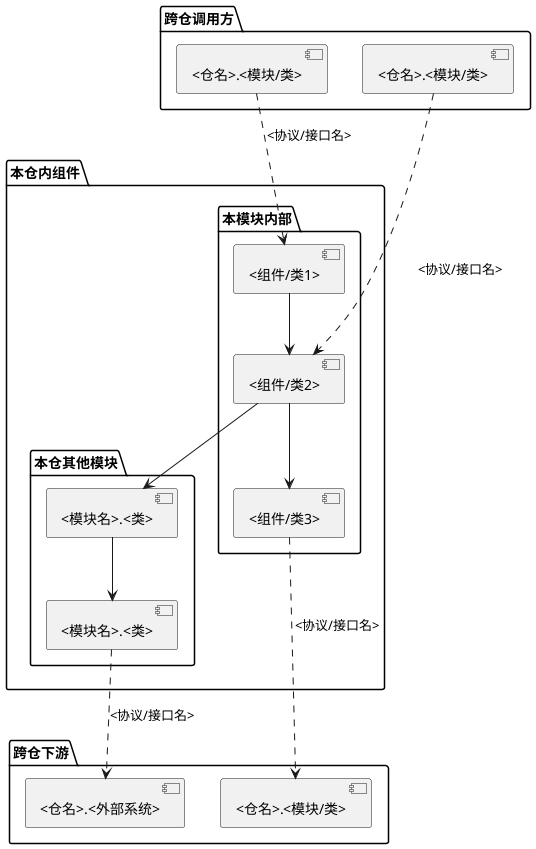
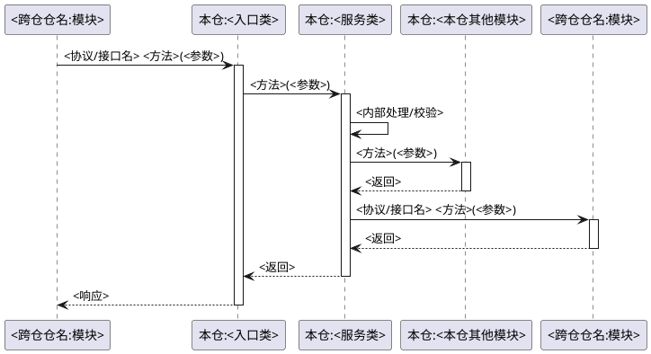

# 模块文档：<业务功能名>

> 五块结构：职责与边界 / 类设计 / 功能点 / 硬约束与规格 / 排查经验
> 模块按**业务功能**划分，不按代码目录划分。一个模块可能跨多个代码目录。
> 模板来源：`templates/repo/module-doc.md`

## 一、职责与边界

### 1. 定位

<!-- 一段话描述该模块在系统中的角色和核心职责。模块按业务功能划分，可能跨多个代码目录。 -->

### 2. 边界

| 维度 | 说明 |
|------|------|
| **本模块负责** | <列举核心职责> |
| **本模块不负责** | <列举明确不属于本模块的职责> |
| **上游调用方（本仓内）** | <本仓哪些模块调用本模块> |
| **上游调用方（跨仓）** | <哪些仓/外部系统调用本模块，通过什么协议> |
| **下游依赖（本仓内）** | <本模块调用本仓哪些模块> |
| **下游依赖（跨仓）** | <本模块调用哪些仓/外部系统，通过什么协议> |

### 3. 模块架构图

<!-- 展示模块内部组件、本仓其他模块、跨仓调用方与跨仓下游之间的关系。用 package 区分边界，跨仓边界用虚线箭头 -->



### 4. 跨仓交互

<!-- 列出本模块与外部仓的所有交互点，标注协议、接口名、调用方向。详细契约指向 domain-docs/interfaces/ 下的接口文档 -->

| 方向 | 对端仓 | 接口/方法 | 协议 | 说明 | 契约文档 |
|------|--------|----------|------|------|---------|
| 提供 → | <仓名> | `<方法签名>` | <REST / CORBA / gRPC / HTTP> | <一句话> | `domain-docs/interfaces/<本仓-对端仓>.md#<接口名>` |
| 调用 ← | <仓名> | `<方法签名>` | <REST / CORBA / gRPC / HTTP> | <一句话> | `domain-docs/interfaces/<对端仓-本仓>.md#<接口名>` |

## 二、类设计

<!-- 用类图展示核心类之间的关系，每个核心类用一句话说明其职责 -->

### 1. 类图

```plantuml
@startuml
class <类A> {
    +<属性A>: <类型>
    +<方法A>()
}
class <类B> {
    +<属性B>: <类型>
    +<方法B>()
}
class <类C> {
    +<属性C>: <类型>
    +<方法C>()
}
<类A> --> <类B> : <关系描述>
<类A> --> <类C> : <关系描述>
<类B> ..> <接口> : 实现
@enduml
```

### 2. 核心类职责

| 类名 | 文件位置 | 职责 |
|------|---------|------|
| <类A> | `<文件路径>:<行号>` | <一句话说明该类的核心职责> |
| <类B> | `<文件路径>:<行号>` | <一句话说明该类的核心职责> |
| <类C> | `<文件路径>:<行号>` | <一句话说明该类的核心职责> |

## 三、功能点

<!-- 每个功能点用时序图展示调用流程，按需辅以状态图说明实体状态流转。目的是讲清楚业务逻辑。
     时序图为必须绘制内容，不可省略，不可偷懒。 -->

### 功能一：<功能名称>

**触发方式**：<REST API / 定时任务 / 事件 / 手动>

**入口**：`<文件路径>:<类.方法>`

**时序图**（**必须绘制，不可省略**）：

<!-- 每个功能点必须有自己的时序图。参与者以仓为单位命名，本仓参与者用"本仓:类名"格式，跨仓参与者用"仓名:模块名"格式。跨仓调用需标注协议和接口名。不可省略时序图。 -->



**状态图**（按需，当功能涉及实体状态流转时补充）：

<!-- 仅当功能中有明确的状态转换时才画，不是每个功能都需要 -->

```plantuml
@startuml
[*] --> <状态A>
<状态A> --> <状态B> : <触发条件/动作>
<状态B> --> <状态C> : <触发条件/动作>
<状态C> --> [*] : <完成条件>
@enduml
```

**关键逻辑**：

1. <步骤1描述及对应的代码位置>
2. <步骤2描述及对应的代码位置>
3. <步骤3描述及对应的代码位置>

**异常处理**：

| 异常场景 | 处理方式 | 对应代码 |
|---------|---------|---------|
| <场景1> | <处理> | `<文件>:<行号>` |

### 功能二：<功能名称>

<!-- 重复上述结构 -->

## 四、硬约束与规格

<!-- 不可违反的技术约束（性能/安全/兼容性）+ 模块级业务规则、数据格式、协议约定、配置项 -->

### 1. 硬约束

| 约束 | 描述 | 原因 |
|------|------|------|
| <约束1> | <描述> | <原因> |
| <约束2> | <描述> | <原因> |

### 2. 数据规格

| 数据项 | 格式 | 取值范围 | 说明 |
|--------|------|---------|------|
| <数据A> | <格式> | <范围> | <说明> |

### 3. 业务规则

- <规则1>
- <规则2>

### 4. 配置项

| 配置 | 默认值 | 说明 |
|------|--------|------|
| <配置A> | <默认> | <说明> |

## 五、排查经验

<!-- 初始为空，随真实排查案例积累。不要编造排查经验 -->

（暂无排查经验，待积累）
