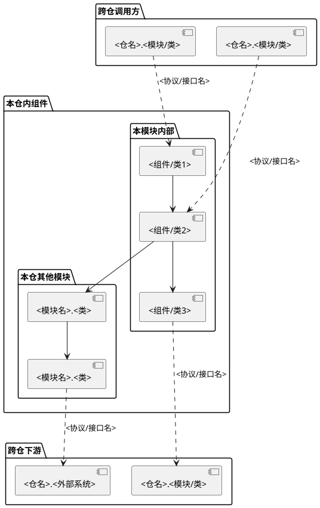
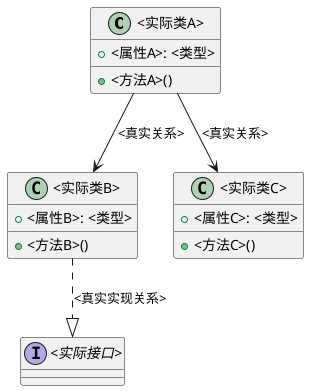
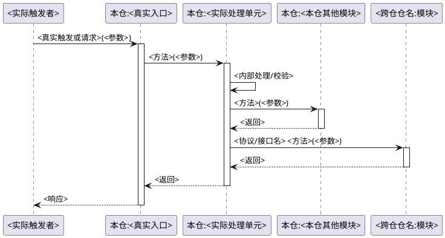
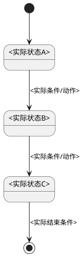

# 模块文档：<业务功能名>

> 五块结构：职责与边界 / 类设计 / 功能点 / 硬约束与规格 / 排查经验
> 模块按**业务功能**划分，不按代码目录划分。一个模块可能跨多个代码目录。
> 本文是所选业务范围内的一个业务功能，首次按 repository-v1 生成时保存在该仓 docs/modules/ 下；已有文稿沿用保存路径；同仓其他业务只追踪解释当前链路所需的调用边界。

<!-- 按实际业务功能填写完整内容，示例中的类、功能、参与方和表格行按源码实际数量展开。没有某类关系或机制时说明已核查范围，不为填图补造类、跨仓调用、状态或规则。 -->

## 一、职责与边界

### 1. 定位

<!-- 一段话描述该模块在系统中的角色和核心职责。模块按业务功能划分，可能跨多个代码目录。 -->

### 2. 边界

| 维度 | 说明 |
|------|------|
| **本模块负责** | <列举核心职责> |
| **本模块不负责** | <列举明确不属于本模块的职责> |
| **上游调用方（本仓内）** | <本仓哪些模块调用本模块> |
| **上游调用方（跨仓）** | <哪些仓/外部系统调用本模块，通过什么协议> |
| **下游依赖（本仓内）** | <本模块调用本仓哪些模块> |
| **下游依赖（跨仓）** | <本模块调用哪些仓/外部系统，通过什么协议> |

### 3. 模块架构图

<!-- 展示真实模块内部组件及其边界。下方各 package 仅在存在对应关系时保留；跨仓边界用虚线箭头，注明真实协议/接口，不能把进程内库画成远程系统。 -->

### 4. 跨仓交互

<!-- 列出本功能与外部仓的全部实际交互点，标注协议、接口名、调用方向。详细契约指向领域目标实际 docs_path/interfaces/ 下的对应文稿 -->

| 本仓角色 | 实际调用方向 | 接口/方法 | 协议 | 条件及用途 | 契约文档 |
|----------|--------------|----------|------|-----------|----------|
| 提供接口 | <调用方仓> → 本仓 | `<真实签名>` | <实际协议> | <触发条件及用途> | <领域知识仓>：`<领域 target.docs_path>/interfaces/<调用方仓>-<本仓>.md`，<真实章节> |
| 调用接口 | 本仓 → <被调用方仓> | `<真实签名>` | <实际协议> | <触发条件及用途> | <领域知识仓>：`<领域 target.docs_path>/interfaces/<本仓>-<被调用方仓>.md`，<真实章节> |

<!-- 仅保留真实交互，外部系统指向实际系统画像；没有跨仓交互时说明核查范围。跨仓文档写明目标仓和仓内路径，不将其伪装成本仓相对路径。章节锚点仅在实际确认后填写。 -->

## 二、类设计

<!-- 有真实类时用类图表达继承、组合及依赖，每个核心类说明职责。函数式/过程式实现保留本节，使用真实函数、模块或数据结构的依赖图与职责表，不发明面向对象类或属性。 -->

### 1. 核心实现关系图

### 2. 核心实现单元职责

| 类/函数/模块 | 文件位置 | 职责 |
|--------------|---------|------|
| <实际实现单元> | `<仓编号>:<文件路径>:<行号>` | <有源码依据的核心职责> |

## 三、功能点

<!-- 每个真实功能点用时序图展示完整调用与结果，按需辅以状态图。入口、API定义和处理函数指向同一功能时去重并列出映射；多个独立场景分别展开，纯参数分支可在同图说明。功能点数量来自覆盖清单，不限定为示例中的两个。 -->

### 功能一：<功能名称>

**触发方式**：<REST API / 定时任务 / 事件 / 手动>

**入口**：`<仓编号>:<文件路径>#<真实类.方法或函数符号>`

**前置条件与输入**：<真实校验顺序、配置开关、参数构造和适用范围，附源码/资料位置>

**时序图**（每个实际功能点均须绘制）：

<!-- 本仓参与者用"本仓:实际类/函数/模块"，跨仓参与者用"仓名:实际实现单元"。实际触发者可以是用户、定时器、事件或其他仓；没有跨仓调用的功能只画真实本仓流程。跨仓调用标明协议和接口；用 alt/else/opt/loop 等表达影响结果的条件、失败与重复处理，保留返回后的使用和副作用顺序。复杂流程按真实子流程拆图并注明衔接，不凭参与者数量省略节点。 -->

**状态图**（按需，当功能涉及实体状态流转时补充）：

<!-- 仅当功能中有明确的状态转换时才画，不是每个功能都需要 -->

**关键逻辑**：

1. <步骤1描述及对应的代码位置>
2. <步骤2描述及对应的代码位置>
3. <步骤3描述及对应的代码位置>

**异常处理**：

| 条件/异常场景 | 已发生的动作与状态 | 处理、传播和返回后的行为 | 对应代码 |
|---------------|-------------------|--------------------------|----------|
| <真实分支> | <操作顺序及副作用> | <实际行为；无补偿/重试则如实说明> | `<仓编号>:<文件>:<行号>` |

### 功能二：<功能名称>

<!-- 按实际功能点清单重复上述结构，不以篇幅或主要/次要筛掉定时任务、事件、条件和异常流程。 -->

## 四、硬约束与规格

<!-- 记录有依据的技术约束与模块业务规则，区分资料要求和现有实现；来源不足的设计原因、性能保证和部署值明确未知。并发保护与重复请求处理需写清范围及成立条件。 -->

### 1. 硬约束

| 约束 | 内容与成立条件 | 依据 | 原因的已知范围 |
|------|----------------|------|----------------|
| <实际约束> | <明确条件及边界> | <源码或资料位置> | <资料支持的原因；缺失则说明> |

### 2. 数据规格

| 数据项 | 格式 | 取值范围 | 说明 |
|--------|------|---------|------|
| <数据A> | <格式> | <范围> | <说明> |

### 3. 业务规则

- <规则1>
- <规则2>

### 4. 配置项

| 配置 | 默认值及单位 | 覆盖方式与作用条件 | 依据 |
|------|--------------|-------------------|------|
| <实际配置> | <源码默认；无默认则说明> | <覆盖优先级，部署实值未知时不推测> | <定义与使用位置> |

## 五、排查经验

<!-- 没有真实案例时保留下方说明。有本次提供或既有可证实案例时，记录现象、依据和实际验证状态；复杂案例链接到本模块 experience/ 下的真实文稿。普通异常分支只支持排查方向，不证明发生过事故或修复已成功。 -->

（暂无排查经验，待积累）
