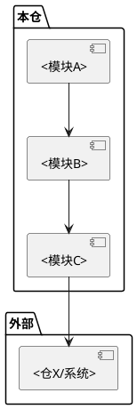

# 模块路由表

> 功能关键词 → 入口 → 模块 → 文档 → 关联下游。
> 模块按**业务功能**划分，不按代码目录划分。一个模块可能跨多个代码目录。
> 模板来源：`templates/repo/module-map.md`

## 一、使用说明

通过功能关键词快速定位到模块入口和文档。

## 二、模块清单

> 模块名使用业务功能名（如 `trace-task-create`），不使用代码目录名（如 `domain-task-create`）。

| 模块名 | 职责概述 | 涉及源码目录 | 文档路径 |
|--------|---------|-------------|---------|
| <业务功能A> | <一句话> | `<源码目录1>`, `<源码目录2>` | `modules/<业务功能A>/<业务功能A>.md` |
| <业务功能B> | <一句话> | `<源码目录>` | `modules/<业务功能B>/<业务功能B>.md` |
| <业务功能C> | <一句话> | `<源码目录1>`, `<源码目录2>`, `<源码目录3>` | `modules/<业务功能C>/<业务功能C>.md` |

## 三、功能索引

| 功能关键词 | 模块 | 入口文件/类 | 关联下游 |
|-----------|------|------------|---------|
| <关键词> | <模块A> | `<文件>:<类/函数>` | <模块B / 仓X> |
| <关键词> | <模块B> | `<文件>:<类/函数>` | <模块C / 外部系统> |
| <关键词> | <模块C> | `<文件>:<类/函数>` | <模块A / 仓Y> |

## 四、模块依赖关系

