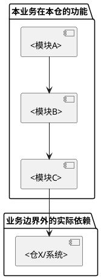

# <业务模块名称>的功能路由表

> 功能关键词 → 入口 → 模块 → 文档 → 关联下游。
> 模块按**业务功能**划分，不按代码目录划分。一个模块可能跨多个代码目录。
> 本文只索引所选业务在本仓的功能；这里的模块名使用业务功能名称。repository-v1 首次生成时本文位于 docs/module-map.md，入口是同目录 README.md；已保存文稿及其他布局沿用当前实际位置。

<!-- 以实际入口到完整业务功能的对应关系组织，不把 endpoint、IDL 方法、处理函数和定时入口重复算成同一功能的多份文稿。多个入口属于同一功能时列全入口；一个入口按条件实现多个场景时列清各场景。示例行按实际数量展开。 -->

## 一、使用说明

通过功能关键词定位本业务的功能入口和文档。同仓其他业务只作为实际调用边界说明，不成为本任务必须补齐的文稿。

## 二、模块清单

> 模块名使用业务功能名（如 `trace-task-create`），不使用代码目录名（如 `domain-task-create`）。

| 模块名 | 职责概述 | 涉及源码目录 | 文档路径 |
|--------|---------|-------------|---------|
| <业务功能A> | <一句话> | `<源码目录1>`, `<源码目录2>` | `modules/<业务功能A>/<业务功能A>.md` |
| <业务功能B> | <一句话> | `<源码目录>` | `modules/<业务功能B>/<业务功能B>.md` |
| <业务功能C> | <一句话> | `<源码目录1>`, `<源码目录2>`, `<源码目录3>` | `modules/<业务功能C>/<业务功能C>.md` |

## 三、功能索引

| 功能关键词/场景 | 业务模块 | 入口与触发方式 | 适用条件 | 关联下游及依据 |
|-----------------|----------|----------------|----------|----------------|
| <实际功能关键词> | <实际模块> | `<仓编号>:<文件>#<符号>`；<公开接口/定时/事件/手动等真实触发> | <配置或条件> | <本仓模块/其他仓/外部系统与源码位置> |

<!-- 核对范围内所有唯一业务入口都有去向或明确排除理由；不以入口数量等于文档数量判断完整。跨仓依赖指真实运行交互，静态构建候选必须经过源码核实。 -->

## 四、模块依赖关系

<!-- 按真实关系替换节点与边，给出方向、接口或业务含义；没有外部依赖时删除示例外部节点。图过大按完整业务链路拆分并标注衔接，不省略已确认依赖。 -->

